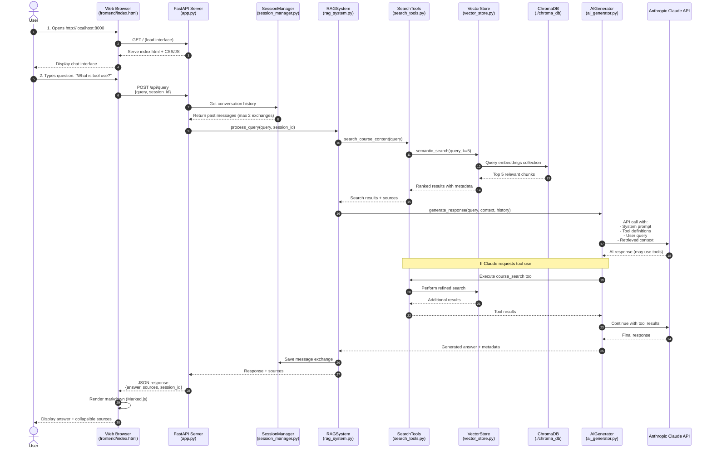

# RAG Chatbot Application Flow Diagram

## User Flow: Querying the Chatbot



---

## Admin Flow: Setting Up and Deploying

```mermaid
flowchart TD
    Start([Admin starts setup]) --> CheckPrereq{Prerequisites<br/>installed?}

    CheckPrereq -->|No| InstallPrereq[Install Prerequisites:<br/>- Python 3.13+<br/>- uv package manager]
    CheckPrereq -->|Yes| CloneRepo[Clone/navigate to repository]

    InstallPrereq --> CloneRepo

    CloneRepo --> CreateEnv[Create .env file<br/>Add ANTHROPIC_API_KEY]

    CreateEnv --> AddDocs[Add course documents to /docs/<br/>Format: Structured text files]

    AddDocs --> InstallDeps[Run: uv sync<br/>Install all dependencies]

    InstallDeps --> RunScript[Execute: ./run.sh]

    RunScript --> StartupSeq[Startup Sequence Begins]

    StartupSeq --> InitFastAPI[FastAPI app initializes]
    InitFastAPI --> LoadConfig[Load config.py settings]
    LoadConfig --> InitComponents[Initialize components:<br/>- RAGSystem<br/>- VectorStore<br/>- AIGenerator<br/>- SessionManager]

    InitComponents --> StartupEvent[Trigger startup event]
    StartupEvent --> ScanDocs[Scan ../docs/ folder]

    ScanDocs --> ProcessDocs[DocumentProcessor parses each file]
    ProcessDocs --> ExtractMeta[Extract metadata:<br/>- Course title<br/>- Instructor<br/>- Lessons<br/>- Links]

    ExtractMeta --> ChunkContent[Chunk content:<br/>- Size: 800 chars<br/>- Overlap: 100 chars]

    ChunkContent --> GenerateEmbed[Generate embeddings:<br/>sentence-transformers<br/>all-MiniLM-L6-v2]

    GenerateEmbed --> StoreVectors[Store in ChromaDB:<br/>- course_catalog collection<br/>- course_content collection]

    StoreVectors --> StartServer[Uvicorn starts server<br/>Port: 8000<br/>Reload: enabled]

    StartServer --> ServerReady{Server<br/>ready?}

    ServerReady -->|Yes| AdminAccess[Admin can access:<br/>- Web UI: http://localhost:8000<br/>- API docs: /docs<br/>- Course stats: /api/courses]

    ServerReady -->|Error| CheckLogs[Check logs for errors:<br/>- Missing API key?<br/>- Port conflict?<br/>- Invalid documents?]

    CheckLogs --> FixIssue[Fix issue]
    FixIssue --> RunScript

    AdminAccess --> Monitor[Monitor application:<br/>- View console logs<br/>- Check ChromaDB data<br/>- Test queries via /docs]

    Monitor --> Update{Need to<br/>update?}

    Update -->|Add documents| AddMoreDocs[Add new files to /docs/]
    Update -->|Change config| ModifyConfig[Update config.py or .env]
    Update -->|No| Running([Application running])

    AddMoreDocs --> Restart[Restart server<br/>Ctrl+C then ./run.sh]
    ModifyConfig --> Restart
    Restart --> StartupSeq

    style Start fill:#4CAF50
    style Running fill:#4CAF50
    style ServerReady fill:#FF9800
    style CheckPrereq fill:#FF9800
    style Update fill:#FF9800
    style CheckLogs fill:#f44336
```



---

## Component Interaction Map

```
┌─────────────────────────────────────────────────────────────────┐
│                         USER INTERACTION                         │
└─────────────────────────────────────────────────────────────────┘
                                 │
                                 ▼
┌─────────────────────────────────────────────────────────────────┐
│                    FRONTEND (Browser Layer)                      │
│  ┌──────────────┐  ┌──────────────┐  ┌──────────────┐          │
│  │ index.html   │  │  script.js   │  │  style.css   │          │
│  │ - Chat UI    │  │ - API calls  │  │ - Dark theme │          │
│  │ - Input form │  │ - Rendering  │  │ - Responsive │          │
│  └──────────────┘  └──────────────┘  └──────────────┘          │
└─────────────────────────────────────────────────────────────────┘
                                 │
                          HTTP POST/GET
                                 ▼
┌─────────────────────────────────────────────────────────────────┐
│                    BACKEND (API Layer)                           │
│  ┌─────────────────────────────────────────────────────────┐   │
│  │                      app.py (FastAPI)                     │   │
│  │  Endpoints:                                               │   │
│  │  • POST /api/query    → Process user questions            │   │
│  │  • GET  /api/courses  → Get course statistics             │   │
│  │  • GET  /            → Serve frontend files               │   │
│  └─────────────────────────────────────────────────────────┘   │
└─────────────────────────────────────────────────────────────────┘
                                 │
                                 ▼
┌─────────────────────────────────────────────────────────────────┐
│                 APPLICATION LOGIC (RAG Layer)                    │
│                                                                   │
│  ┌──────────────────────────────────────────────────────────┐  │
│  │              rag_system.py (Orchestrator)                 │  │
│  │  • Coordinates all components                             │  │
│  │  • Manages RAG pipeline                                   │  │
│  │  • Handles document ingestion                             │  │
│  └──────────────────────────────────────────────────────────┘  │
│                           │                                      │
│        ┌──────────────────┼──────────────────┐                  │
│        │                  │                  │                  │
│        ▼                  ▼                  ▼                  │
│  ┌──────────┐      ┌──────────┐      ┌──────────┐             │
│  │ session_ │      │ search_  │      │   ai_    │             │
│  │ manager  │      │  tools   │      │generator │             │
│  │          │      │          │      │          │             │
│  │ • History│      │ • Tool   │      │ • Claude │             │
│  │ • Context│      │   system │      │   API    │             │
│  └──────────┘      └──────────┘      └──────────┘             │
│                           │                  │                  │
│                           ▼                  │                  │
│                    ┌──────────┐              │                  │
│                    │ vector_  │              │                  │
│                    │  store   │              │                  │
│                    │          │              │                  │
│                    │ • Search │              │                  │
│                    │ • Filter │              │                  │
│                    └──────────┘              │                  │
└─────────────────────────────────────────────────────────────────┘
                           │                  │
                           ▼                  ▼
┌─────────────────────────────────────────────────────────────────┐
│                 EXTERNAL SERVICES & DATA                         │
│                                                                   │
│  ┌──────────────────┐              ┌──────────────────┐         │
│  │   ChromaDB       │              │  Anthropic API   │         │
│  │  (./chroma_db)   │              │  Claude Sonnet 4 │         │
│  │                  │              │                  │         │
│  │ • course_catalog │              │ • LLM inference  │         │
│  │ • course_content │              │ • Tool calling   │         │
│  │ • Embeddings     │              │ • Max 800 tokens │         │
│  └──────────────────┘              └──────────────────┘         │
└─────────────────────────────────────────────────────────────────┘
                           ▲
                           │
                    On Startup Only
                           │
┌─────────────────────────────────────────────────────────────────┐
│              DOCUMENT PROCESSING (Initialization)                │
│                                                                   │
│  ┌──────────────────────────────────────────────────────────┐  │
│  │           document_processor.py                           │  │
│  │  • Parse course documents from /docs                      │  │
│  │  • Extract metadata (title, instructor, lessons)          │  │
│  │  • Chunk content (800 chars, 100 overlap)                 │  │
│  │  • Generate embeddings (sentence-transformers)            │  │
│  └──────────────────────────────────────────────────────────┘  │
│                           ▲                                      │
│                           │                                      │
│  ┌──────────────────────────────────────────────────────────┐  │
│  │                  /docs/ folder                            │  │
│  │  • course1_script.txt                                     │  │
│  │  • course2_script.txt                                     │  │
│  │  • course3_script.txt                                     │  │
│  │  • course4_script.txt                                     │  │
│  └──────────────────────────────────────────────────────────┘  │
└─────────────────────────────────────────────────────────────────┘
```

---

## Data Flow: Single Query Example

**Scenario**: User asks "What is prompt caching in Anthropic?"

```
1. USER INPUT
   └─> "What is prompt caching in Anthropic?"

2. FRONTEND (script.js)
   └─> POST /api/query
       Body: {
         "query": "What is prompt caching in Anthropic?",
         "session_id": "abc123"
       }

3. BACKEND (app.py)
   └─> Receive request
   └─> session_manager.get_history("abc123")
       Returns: [previous conversation messages]

4. RAG SYSTEM (rag_system.py)
   └─> process_query(query, session_id)

5. SEARCH TOOLS (search_tools.py)
   └─> course_search_tool.execute(query)
   └─> vector_store.semantic_search("What is prompt caching", k=5)

6. VECTOR STORE (vector_store.py)
   └─> Generate query embedding using sentence-transformers
   └─> ChromaDB.query(embedding, n_results=5)
       Returns: [
         {content: "Prompt caching allows...", course: "Building with Anthropic", lesson: 3},
         {content: "Cache feature reduces...", course: "Building with Anthropic", lesson: 3},
         ...
       ]

7. AI GENERATOR (ai_generator.py)
   └─> Build context from search results
   └─> Create messages array:
       [
         {role: "user", content: "Previous question"},
         {role: "assistant", content: "Previous answer"},
         {role: "user", content: "What is prompt caching in Anthropic?"}
       ]
   └─> anthropic.messages.create(
         model="claude-sonnet-4-20250514",
         system="You are a helpful assistant...",
         messages=[...],
         tools=[course_search_tool],
         max_tokens=800,
         temperature=0
       )

8. CLAUDE API
   └─> Process request
   └─> May decide to use course_search tool for additional context
   └─> Generate response: "Prompt caching is a feature in Anthropic's Claude API that..."

9. RESPONSE ASSEMBLY (rag_system.py)
   └─> Extract answer text
   └─> Collect sources: ["Building with Anthropic - Lesson 3"]
   └─> session_manager.add_message(session_id, user_msg, assistant_msg)

10. API RESPONSE (app.py)
    └─> Return JSON:
        {
          "answer": "Prompt caching is a feature...",
          "sources": [
            {"course": "Building with Anthropic", "lesson": 3, "link": "..."}
          ],
          "session_id": "abc123"
        }

11. FRONTEND RENDERING (script.js)
    └─> Receive response
    └─> Parse markdown with Marked.js
    └─> Display answer in chat bubble
    └─> Add collapsible sources section
    └─> Show on screen

12. USER SEES ANSWER
    └─> Formatted response with clickable source links
```

---

## Key Differences: User vs Admin

| Aspect | User Perspective | Admin Perspective |
|--------|------------------|-------------------|
| **Entry Point** | Web browser UI | Command line / terminal |
| **Primary Actions** | Ask questions, view answers | Configure, deploy, monitor |
| **Interaction** | Chat interface | Shell commands, config files |
| **Concerns** | Answer quality, sources | System health, performance, costs |
| **Tools Used** | Mouse, keyboard | uv, git, text editor, .env files |
| **Frequency** | Continuous during session | Setup once, monitor occasionally |
| **Data Flow** | Query → Response | Documents → Vector DB → API Ready |
| **Visibility** | Chat messages only | Full system logs, ChromaDB, API docs |
| **Success Metric** | Relevant answers | Server running, documents loaded |

