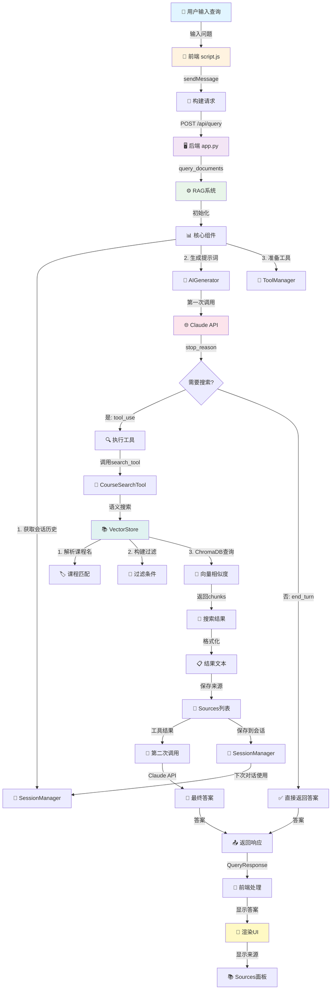

# 用户查询处理流程图

## 流程说明

### 1️⃣ 前端层（script.js）
- 用户输入查询 → 点击发送
- 构建请求：`{query, session_id}`
- POST到 `/api/query`
- 显示加载动画

### 2️⃣ 后端API层（app.py）
- 接收 `QueryRequest`
- 创建或使用现有 `session_id`
- 调用 `rag_system.query()`
- 返回 `QueryResponse {answer, sources, session_id}`

### 3️⃣ RAG系统核心（rag_system.py）
- 获取会话历史（用于多轮对话）
- 调用 AI 生成器，传入工具定义
- 从工具管理器获取来源
- 保存会话交互

### 4️⃣ AI生成层（ai_generator.py）
**第一次调用：**
- 构建系统提示词
- 发送查询 + 工具定义到 Claude API
- Claude 判断是否需要搜索

**两种情况：**
- ✅ `stop_reason == "end_turn"` → 直接返回答案
- 🔍 `stop_reason == "tool_use"` → 执行工具

**第二次调用（如需搜索）：**
- 执行工具获得搜索结果
- 将结果发回 Claude
- Claude 基于搜索结果生成最终答案

### 5️⃣ 工具执行层（search_tools.py）
- `CourseSearchTool.execute()` 调用向量存储
- 格式化搜索结果
- 保存来源信息供前端显示

### 6️⃣ 向量搜索层（vector_store.py）
- 解析课程名（如有指定）
- 构建过滤条件（课程、课时）
- 使用 ChromaDB 进行语义搜索
- 返回最相关的 chunks

### 7️⃣ 会话管理（session_manager.py）
- 创建新会话或使用现有会话
- 保存对话历史
- 下次查询时提供上下文

### 8️⃣ 前端响应（script.js）
- 接收 `{answer, sources, session_id}`
- 用 marked.js 将 Markdown 转为 HTML
- 显示答案
- 显示可折叠的 Sources 面板
- 启用输入框，聚焦光标

## 关键设计点

| 设计 | 优势 |
|------|------|
| Claude 作为编排器 | 自动决定是否需要搜索，减少不必要的API调用 |
| 工具调用模式 | 搜索结果只在需要时获取，节省成本 |
| 会话管理 | 支持多轮对话，保持上下文 |
| 向量搜索 | 语义理解，比关键词搜索更准确 |
| 来源追踪 | 用户可验证答案的信息来源 |

## 成本优化

1. **单次搜索**：系统提示词限制每个查询最多一次搜索
2. **缓存利用**：会话历史避免重复处理
3. **智能决策**：Claude 判断何时需要搜索，何时用已知知识回答
