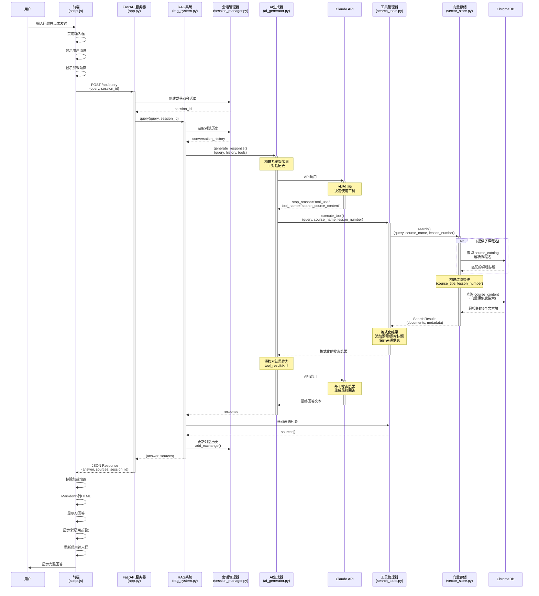
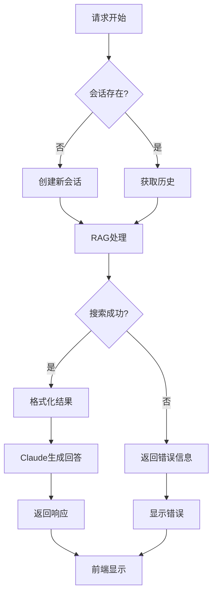

# RAG 聊天机器人前后端交互流程图

## 完整请求流程序列图



## 数据流转详解

### 1. 前端请求阶段
```
用户输入 → 前端验证 → 构建请求体 → HTTP POST
```

**请求数据结构**:
```json
{
    "query": "What is MCP?",
    "session_id": "session_1"
}
```

### 2. 后端处理阶段
```
FastAPI接收 → 会话管理 → RAG系统 → AI生成器
```

### 3. AI工具调用阶段
```
Claude分析 → 决定使用工具 → 执行搜索 → 向量检索
```

### 4. 响应返回阶段
```
格式化结果 → Claude生成回答 → 提取来源 → 返回JSON
```

**响应数据结构**:
```json
{
    "answer": "MCP stands for Model Context Protocol...",
    "sources": [
        "Introduction to MCP Servers - Lesson 1",
        "Introduction to MCP Servers - Lesson 2"
    ],
    "session_id": "session_1"
}
```

### 5. 前端渲染阶段
```
接收JSON → Markdown渲染 → 显示回答 → 显示来源
```

## 关键交互点

### 🔄 会话管理
- **首次请求**: `session_id = null` → 后端创建新会话
- **后续请求**: 使用已有 `session_id` → 保持对话上下文
- **历史限制**: 最多保留2轮对话（4条消息）

### 🔧 工具调用机制
- **自动决策**: Claude自动判断是否需要搜索
- **两次API调用**:
  1. 第一次: 决定工具使用
  2. 第二次: 基于工具结果生成回答

### 🔍 向量搜索
- **语义匹配**: 使用向量相似度而非关键词
- **课程解析**: 模糊匹配课程名（如 "MCP" → "Introduction to MCP Servers"）
- **过滤机制**: 支持按课程和课时过滤

### 📊 来源追踪
- **搜索时记录**: 工具执行时保存来源
- **格式化显示**: `课程标题 - Lesson N`
- **可折叠UI**: 前端使用 `<details>` 标签

## 技术栈映射

| 层级 | 组件 | 技术 |
|------|------|------|
| 前端 | UI交互 | HTML + CSS + JavaScript |
| 前端 | Markdown渲染 | Marked.js |
| 后端 | Web框架 | FastAPI + Uvicorn |
| 后端 | RAG协调 | Python (自定义) |
| AI | 语言模型 | Claude Sonnet 4 (Anthropic API) |
| 存储 | 向量数据库 | ChromaDB |
| 嵌入 | 向量化 | all-MiniLM-L6-v2 |

## 性能优化点

1. **预构建参数**: AI Generator 预先构建基础API参数
2. **持久化存储**: ChromaDB 使用磁盘持久化
3. **去重机制**: 避免重复加载相同课程
4. **限制结果数**: 最多返回5个搜索结果
5. **历史限制**: 对话历史限制为2轮，减少token消耗

## 错误处理流程



## 文件对应关系

| 功能 | 文件路径 | 行号参考 |
|------|----------|----------|
| 前端发送请求 | `frontend/script.js` | 45-96 |
| 后端接收请求 | `backend/app.py` | 56-74 |
| RAG查询处理 | `backend/rag_system.py` | 102-140 |
| AI生成响应 | `backend/ai_generator.py` | 43-135 |
| 工具执行 | `backend/search_tools.py` | 52-114 |
| 向量搜索 | `backend/vector_store.py` | 61-100 |
| 会话管理 | `backend/session_manager.py` | 18-56 |

---

**生成时间**: 2026-01-13
**系统版本**: RAG Chatbot v1.0

